<div align="center">

# Steading

**[herdr](https://herdr.dev) 위에서 돌아가는 에이전트 개발 환경.**

<sub>*steading* (스코틀랜드어): 농가. 살림집과 일하는 건물들을 함께 이르는 말.</sub>

[](LICENSE)
[](https://herdr.dev)
[](https://code.claude.com)

[English](README.md) · **한국어**

</div>

코딩 에이전트는 쉬지 않습니다. 테스트, 빌드, git, 배포, 개발 서버, 서브 에이전트, 그리고 3분째
"실행 중"인 그 명령까지. Steading은 이 모든 것을 **에이전트 옆 deck 하나**에 실시간으로 보여 줍니다.
무슨 일이 일어나는지 알려고 대화를 거슬러 올라갈 필요가 없습니다.



## 탭 여덟 개

| 탭 | 보이는 것 |
|---|---|
| **agents** | 에이전트와 일하는 서브 에이전트 전부. 각자 지금 하는 일, 할 일 진행, 모델. 고른 에이전트는 활동 그래프·컨텍스트·토큰·도구까지 |
| **jobs** | 10초 넘게 걸리는 명령. 무엇을 하려는지, timeout까지 얼마나 남았는지, 나오는 대로의 출력 |
| **servers** | 프로젝트와 같은 herdr 워크스페이스의 개발 서버와 각 서버의 로그. 키 하나로 브라우저에서 열기 |
| **build** · **test** | 실시간 컬러 출력. 에이전트는 그대로 일반 텍스트와 실제 종료 코드를 받음 |
| **git** | 저장소를 바꾸는 명령 전부, 커밋 메시지 전체. 테두리에 브랜치, 푸시하지 않은 커밋, 커밋하지 않은 파일 |
| **deploy** | `vercel`, `fly deploy`, `terraform apply`, `forge script --broadcast` 외 25개 이상. 상태·목록 조회는 제외 |
| **system** | 전체·코어별 CPU, 부하, 메모리. Mac에서 [macmon](https://github.com/vladkens/macmon)이 있으면 GPU, 전력, 온도까지. btop처럼 모든 프로세스를 보여 주고, Claude 세션은 그 아래 프로세스를 합쳐 한 행으로(`enter`로 펼침), 개발 서버는 늘 초록색 별도 행으로. `K`로 종료. `o`로 herdr 워크스페이스에 `btop`(과 `macmon`) 열기 |
| **files** | 이 세션의 에이전트가 읽거나(`◦`) 쓴(`✎`) 파일을 저장소 루트 기준 트리로. 지금 고치는 파일에는 스피너, 파일마다 git `+N -M`. `enter`로 diff, `o`로 herdr 분할에 `$EDITOR`로 열기, `y`로 경로 복사 |

## 신경 쓸 게 없습니다

- **보던 탭을 빼앗지 않습니다.** 새 테스트, 서버, 커밋이 생기면 그 탭이 빨갛게 바뀌고, 그 탭을 볼 때까지 남아 있습니다. 보던 탭은 그대로입니다(덱에서 `,`로 새 실행을 따라 탭이 넘어가게 바꿀 수 있습니다). 닫으면 다시 열 때까지 닫혀 있습니다.
- **에이전트 옆에 놓입니다.** 오른쪽에 열리고, 원하면 `L`로 위로 옮깁니다.
- **기억합니다.** 세션을 새 패널에서 다시 열어도 대화 기록에서 실행 기록을 되살립니다.
- **배울 게 없습니다.** 설정도, 외울 명령도 없습니다. 맨 아래 줄에 지금 쓸 수 있는 키가 늘 보입니다. bash, `jq`, `python3` 말고는 필요한 것도 없습니다.

## 빠른 시작

필요한 것: herdr 0.9+, Claude Code, `jq`, `python3`(3.9 이상, Homebrew 것이 있으면 그것을 씁니다). `curl`은 선택 사항입니다. 있으면 훅이 더 가볍습니다.

| | `python3` | `jq` |
|---|---|---|
| macOS | Command Line Tools에 포함(`xcode-select --install`) | macOS 15부터 기본 포함. 그 이전은 `brew install jq` |
| Linux | 대부분의 배포판에 있음 | `sudo apt install jq`(또는 쓰는 패키지 관리자) |
| Windows | WSL 안에서 Linux와 같게 | WSL 안에서 Linux와 같게 |

Windows에서는 herdr와 Claude Code를 [WSL](https://learn.microsoft.com/ko-kr/windows/wsl/install) 안에서
실행하세요. deck이 Unix 터미널과 셸 스크립트를 쓰기 때문에 herdr의 Windows 네이티브 버전에서는 돌아가지 않습니다.

```sh
herdr plugin install levx-me/steading --yes
```

`claude`가 `PATH`에 있으면 Claude Code 쪽도 함께 설치됩니다. 이미 열려 있는 세션은 Claude가 쉬고 있을 때
`/reload-plugins`를 실행하면 되고, 새 세션은 따로 할 일이 없습니다. 세션이 시작되면 에이전트 옆에 deck이 열립니다.

## 더 알아보기

- **[탭](docs/tabs.ko.md)**: 어떤 명령이 어느 탭으로 가는지, 탭마다 무엇을 보여 주는지.
- **[키와 마우스](docs/keys.ko.md)**: deck 열기·닫기·옮기기, 모든 로그에서 쓰는 herdr 복사 모드 키.
- **[동작 방식](docs/how-it-works.ko.md)**: 훅, 실행 기록 파일, 설정, 보안, 개발.

## 라이선스

[MIT](LICENSE)
