<div align="center">

# Steading

**An agentic development environment on top of [herdr](https://herdr.dev).**

<sub>*steading* (Scots): a farmstead, the house and its working buildings together.</sub>

[](LICENSE)
[](https://herdr.dev)
[](https://code.claude.com)

**English** · [한국어](README.ko.md)

</div>

Your coding agent is busy: tests, builds, git, deploys, dev servers, subagents, that one
command that has been "running" for three minutes. Steading puts all of it in **one deck
beside the agent**, live, so you never scroll back through the conversation to find out.



## Eight tabs, one glance each

| Tab | What you see |
|---|---|
| **agents** | The agent and every subagent at work: what each is doing right now, its tasks and model, and for the one you pick a heartbeat, context, tokens and tools |
| **jobs** | Any command that has run 10s or more, with what it is for and how long it has left before its timeout, output as it comes |
| **servers** | Dev servers of the project and its herdr workspace, each with its log; one key opens it in the browser |
| **build** · **test** | Runs streamed live and in colour, while the agent still gets plain text and the real exit code |
| **git** | Every command that changes the repository, commit messages in full, and the branch, unpushed commits and uncommitted files in the border |
| **deploy** | `vercel`, `fly deploy`, `terraform apply`, `forge script --broadcast` and 25+ more; status and list commands stay out |
| **system** | CPU in all and per core, load and memory, on a Mac with [macmon](https://github.com/vladkens/macmon) also GPU, power and heat; every process as btop lists them, each Claude session one row with what runs under it summed, dev servers marked; `K` ends one. `o` opens `btop` (and `macmon`) in a herdr workspace |

## Why it feels effortless

- **It keeps up without pulling you around.** A new test run, server or commit turns its tab red until you look; the tab you are on stays put (or, with `,` in the deck, follow each new run to its tab). Close the deck and it stays closed until you want it back.
- **It sits beside the agent.** On the right; `L` moves it on top when you want.
- **It remembers.** Resume a session in a new pane and its history comes back from the transcript.
- **It asks nothing of you.** No config, no commands to learn: the bottom row always shows the keys that work right now. bash, `jq` and `python3`, nothing else.

## Quick start

Requirements: herdr 0.9+, Claude Code, `jq` and `python3`.

| | `python3` | `jq` |
|---|---|---|
| macOS | comes with the Command Line Tools (`xcode-select --install`) | built in since macOS 15; before, `brew install jq` |
| Linux | there on most distributions | `sudo apt install jq` (or your package manager) |
| Windows | inside WSL, as on Linux | inside WSL, as on Linux |

On Windows, run herdr and Claude Code inside [WSL](https://learn.microsoft.com/windows/wsl/install):
the deck uses Unix terminals and shell scripts, so herdr's native Windows build cannot host it.

```sh
herdr plugin install levx-me/steading --yes
```

This also installs the Claude Code side when `claude` is on your `PATH`. Open sessions pick it up
with `/reload-plugins` (run it while Claude is idle); new sessions do on their own. The deck opens
beside the agent as soon as a session starts.

## Learn more

- **[The tabs](docs/tabs.md)**: which commands land where, and what each tab shows.
- **[Keys and mouse](docs/keys.md)**: opening, closing and moving the deck, herdr's copy-mode keys in every log.
- **[How it works](docs/how-it-works.md)**: the hooks, the run files, configuration, security and development.

## License

[MIT](LICENSE)
